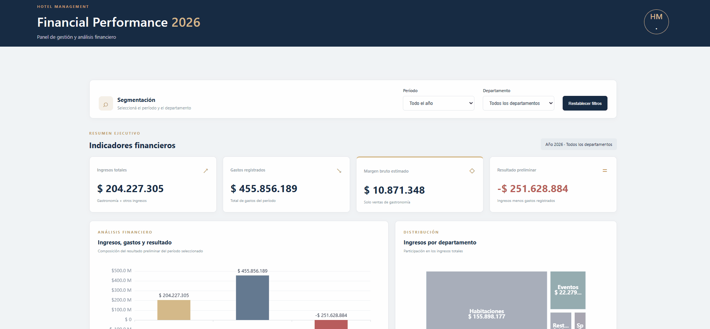

# 🏨 Análisis de Rentabilidad Hotelera 2026

### Dashboard Web Interactivo | Data Analytics | Business Intelligence

Proyecto de análisis de datos aplicado a la gestión financiera hotelera, desarrollado para evaluar ingresos, gastos, márgenes estimados y comportamiento económico de los distintos departamentos de un hotel durante el año 2026.

El proyecto integra procesamiento de datos con Python y Pandas, desarrollo backend con Flask y visualizaciones interactivas mediante Apache ECharts.

---

## 📌 Descripción del proyecto

El objetivo principal es transformar datos económicos y operativos en información útil para la gestión y la toma de decisiones empresariales.

A través del análisis de ingresos, gastos y márgenes estimados, se busca identificar los principales generadores de ingresos, evaluar la estructura de gastos y detectar posibles desequilibrios económicos.

Los resultados se presentan mediante un dashboard web interactivo que permite explorar indicadores financieros y visualizar el comportamiento de los distintos departamentos.

## 🎯 Objetivos

- Analizar los ingresos generados por los departamentos del hotel.
- Evaluar la composición de los gastos registrados.
- Identificar los principales generadores de ingresos.
- Calcular el margen bruto estimado de Restaurante y Bar.
- Comparar la evolución mensual de ingresos y gastos.
- Detectar desequilibrios entre ingresos y gastos.
- Desarrollar visualizaciones interactivas para facilitar la interpretación de resultados.

## 🛠️ Tecnologías utilizadas

| Tecnología | Aplicación |
|---|---|
| Python | Procesamiento y análisis de datos |
| Pandas | Limpieza, transformación y análisis |
| Flask | Desarrollo del backend |
| HTML5 | Estructura de la aplicación |
| CSS3 | Diseño y estilos visuales |
| JavaScript | Interactividad y actualización de gráficos |
| Apache ECharts | Visualización de datos |
| Excel | Fuente de información |

## 📂 Estructura del proyecto

```text
Hotel_Dashboard/
│
├── app.py
│
├── data/
│   └── Base_Hotel_Rentabilidad_2026_CLEAN.xlsx
│
├── templates/
│   └── index.html
│
├── static/
│   ├── css/
│   │   └── styles.css
│   │
│   └── js/
│       └── dashboard.js
│
└── README.md
```

## 📊 Fuente de datos

Se utilizó una base de datos ficticia correspondiente al año 2026, organizada en las siguientes hojas:

- **Ventas_Gastronomia:** ventas de productos de Restaurante y Bar, cantidades, ingresos y costos estimados.
- **Otros_Ingresos:** ingresos provenientes de Habitaciones, Eventos y Spa.
- **Gastos:** gastos registrados por departamento, categoría y concepto.
- **Personal:** información de empleados y estructura salarial.

## 📈 Indicadores principales

El dashboard presenta cuatro indicadores principales:

| Indicador | Resultado |
|---|---:|
| Ingresos totales | $204.227.305,38 |
| Gastos registrados | $455.856.188,95 |
| Margen bruto estimado | $10.871.347,81 |
| Resultado preliminar | -$251.628.883,57 |

### Análisis de resultados

**Ingresos por departamento**

Habitaciones concentra el 76,34 % de los ingresos registrados, posicionándose como el principal generador de ingresos del hotel.

**Estructura de gastos**

Sueldos representa el 88,20 % de los gastos registrados, constituyendo el principal componente de la estructura de gastos analizada.

**Margen bruto gastronómico**

Restaurante y Bar presentan márgenes brutos estimados cercanos al 57 %, calculados a partir de los ingresos y costos estimados de los productos vendidos.

**Resultado preliminar**

Los gastos registrados superan los ingresos registrados, generando una diferencia negativa de aproximadamente $251,6 millones.

Este resultado evidencia un desequilibrio económico que requiere profundizar el análisis de costos y validar la información antes de obtener conclusiones contables definitivas.

## 📉 Visualizaciones del dashboard

## 🖥️ Vista del dashboard



El dashboard incorpora diferentes representaciones visuales para facilitar el análisis:

- **Waterfall:** comparación entre ingresos, gastos y resultado preliminar.
- **Treemap:** distribución de ingresos por departamento.
- **Gráfico de líneas:** evolución mensual de ingresos y gastos.
- **Gráfico de barras:** composición de gastos por departamento y categoría.

## ⚙️ Funcionalidades

- Visualización de indicadores KPI.
- Filtros interactivos por mes y departamento.
- Actualización dinámica de gráficos e indicadores.
- Ampliación de visualizaciones mediante ventanas modales.
- Análisis de ingresos y gastos por departamento.
- Comparación de resultados mensuales.
- Interfaz web con diseño adaptable.
- Encabezado fijo y navegación visual.

## 💻 Instalación y ejecución

### 1. Clonar el repositorio

```bash
git clone URL_DEL_REPOSITORIO
```

### 2. Ingresar al directorio

```bash
cd Hotel_Dashboard
```

### 3. Crear un entorno virtual

```bash
python -m venv venv
```

### 4. Activar el entorno virtual

En Windows:

```bash
venv\Scripts\activate
```

### 5. Instalar las dependencias

```bash
pip install flask pandas openpyxl
```

### 6. Ejecutar la aplicación

```bash
python app.py
```

### 7. Acceder al dashboard

Abrir el navegador en:

```text
http://127.0.0.1:5000
```

## 💡 Conclusiones

El análisis permitió identificar los principales generadores de ingresos, reconocer la concentración de gastos en personal y evaluar los márgenes brutos estimados del área gastronómica.

Los resultados muestran la importancia de analizar conjuntamente los ingresos y los gastos para detectar desequilibrios económicos, evaluar la estructura operativa y encontrar oportunidades de mejora.

Este proyecto demuestra la aplicación de herramientas de análisis de datos, Business Intelligence y desarrollo web para transformar información económica en indicadores y visualizaciones que contribuyan a la toma de decisiones empresariales.

## ⚠️ Consideraciones

- Los datos utilizados son ficticios y tienen fines educativos y demostrativos.
- El margen bruto corresponde exclusivamente a las ventas gastronómicas analizadas.
- El resultado preliminar surge de restar los gastos registrados a los ingresos registrados.
- El resultado no representa una utilidad o pérdida neta contable.
- La información debe validarse y conciliarse antes de utilizarse para decisiones financieras definitivas.
- La hoja Personal se utiliza como referencia y no debe sumarse nuevamente a los gastos si los salarios ya están incluidos en dicha hoja.

## 👩‍💻 Autora

**Gladys Ramos**

Data Analytics | Business Intelligence | Desarrollo Web

Proyecto desarrollado como parte de mi portfolio profesional, aplicando conocimientos de análisis de datos, procesamiento de información, visualización y desarrollo de aplicaciones web.

